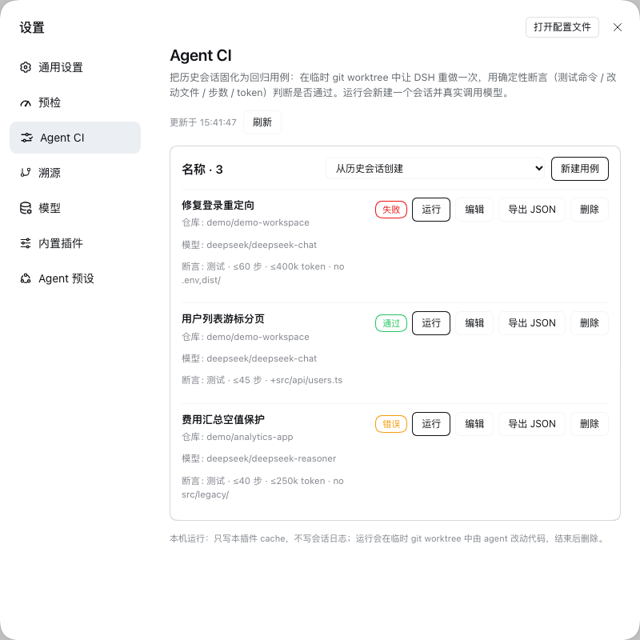
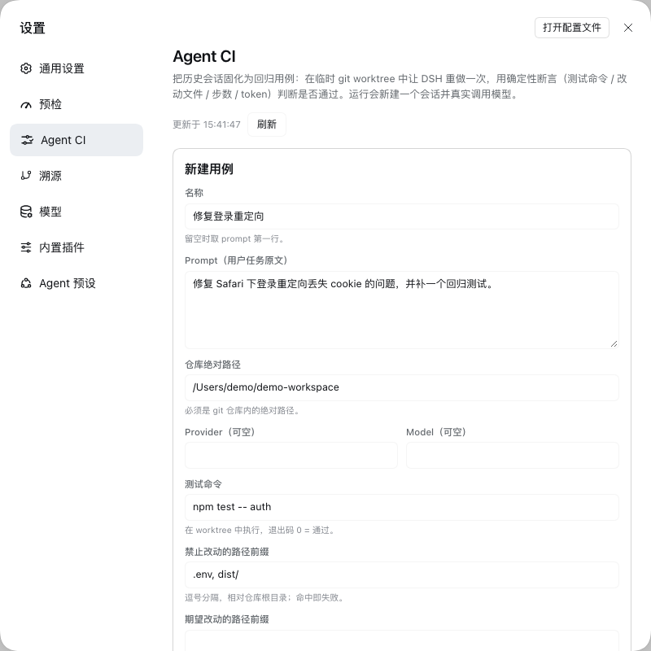
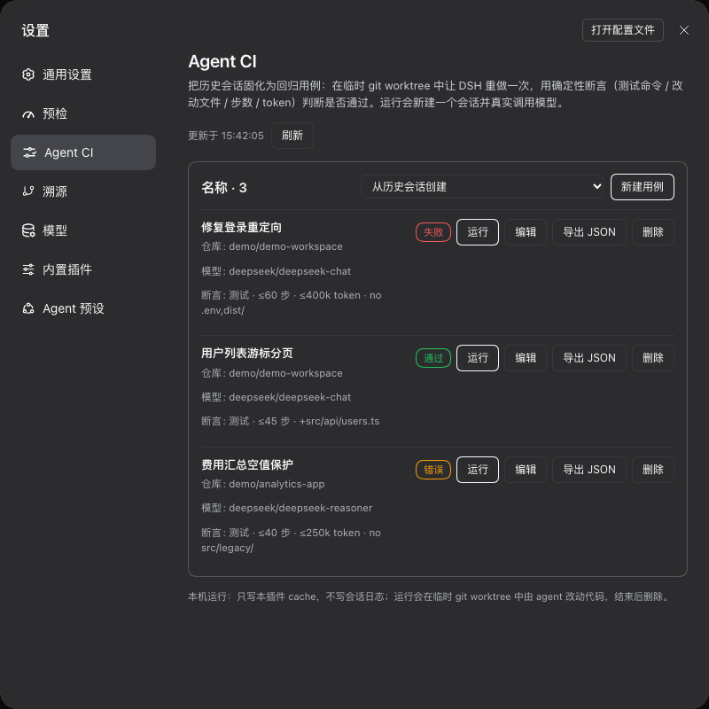

# dsh-agent-ci — DeepSeek Harness 的 Agent CI

把真实会话固化为回归用例，在临时 `git worktree` 中重跑一次，然后用确定性断言检查：测试命令、
改动文件、步数、token。全部本机执行，结果保留为可对比的历史。

> 状态：v0.1.0。需要 DeepSeek Harness 0.2.x，且 `PATH` 中有 `git`。

## 截图





> 截图来自填充了合成用例与运行结果的演示 profile，不包含任何用户数据。

## 安装

**从插件市场** —— 在 DSH 插件市场安装「Agent CI」，重启应用。

**从 GitHub**

```sh
git clone https://github.com/ruaibeite/dsh-agent-ci
# 把目录链接进当前 profile，并把 "@ruaibeite/dsh-agent-ci" 加到
# profiles/<profile>/package.json 的 dsh.profile.bundles，然后重启 DSH
```

插件注册一个设置页（`settings.section`，id `agent-ci`）和一个 host 路由
`/dsh-agent-ci/api`。

## 它做什么

1. **固化用例**。从最近会话创建（自动预填 title / prompt / cwd / 模型），或手动填写：
   prompt、仓库路径、可选模型、断言。
2. **运行**。插件在仓库 `HEAD` 上创建 detached worktree，在其中用同一 prompt 启动一个新的
   DSH agent，等它 idle 后检查：
   - `testCommand` 退出码为 `0`；
   - 改动文件没有命中 `forbiddenPaths` 前缀；
   - 设置 `expectFiles` 时，至少有一个改动命中；
   - 设置 `maxSteps` / `maxTokens` 时，步数与输入+输出 token 不超限。
3. **查看结论**。每次运行一条结果：`passed` / `failed` / `error`，附原因
   （`ok`、`test-failed`、`forbidden-path`、`expect-file-missing`、`max-steps`、`max-tokens`、
   `agent-error`、`no-git`、`service-unavailable`）、步数、token、改动文件、测试输出尾部。
   保留最近 50 次运行，每个用例显示最近一次结果。

用例还可以「导出 JSON」，方便接入你自己的 CI。

## 如何工作

- **用例**存于 `$DSH_HOME/cache/agent-ci/cases.json`（最多 100 个），**运行历史**存于
  `$DSH_HOME/cache/agent-ci/runs.json`（最近 50 条），均为原子写（临时文件 + rename）。
- 「从会话创建」使用的历史会话来自
  `$DSH_HOME/storages/session_projcache/sessions/*.json`（标题、首条 prompt、cwd、模型、步数、
  最近活动时间），扫描是增量的（path + size + mtime）。
- **隔离**：每次运行在 `os.tmpdir()/dsh-agent-ci/case-*` 创建一个独立 worktree
  （`git -C <repo> worktree add --detach <dir> HEAD`），结束后删除；只有删除失败时才把路径留在
  结果里供排查。
- **指标**在 dispose 之前从注入的 `sessionQuery.readSession(...)` 事件读取（`step/start` 数量与
  `assistant/message.data.usage`）。
- 运行流程通过依赖注入实现（`runCase({ case, deps })`），因此可以在没有 Harness 进程、不调用
  模型的情况下用 fake 服务做单测。

## 隐私

- 纯本机：不联网、不上传、无遥测。
- 插件只**读取**会话选择器所需的投影缓存；绝不写会话日志、不 append 事件、不读
  `.credentials.yaml`。
- 插件唯一写入的位置是自己的 `$DSH_HOME/cache/agent-ci/*.json`。
- 运行会创建一个**新的 DSH 会话**并在临时 worktree 中真实调用模型；用户自己的仓库工作区不会被
  修改。

## 已知限制（v0.1.0）

- 只支持**有至少一个提交的 git 仓库**；非 git 目录或无提交仓库会得到 `error/no-git`。需要
  `PATH` 中有 `git`。
- 运行会创建一个可见会话并产生 token 费用。断言是**确定性检查**（测试命令/文件/步数/token），
  不是 LLM judge；测试命令由用户提供。
- 每个 Harness 进程同一时间只跑一个用例；第二次请求返回 `run-in-progress` / HTTP 409。
- worktree 删除是 best-effort；删除失败会保留目录并记录路径。
- 只保留最近 50 次运行；不做跨机器同步或 CI 上传 —— 请用「导出 JSON」接入自己的流水线。
- 「从会话创建」只列出投影缓存中最近 30 个会话；从未投影（或缺少 prompt/cwd）的会话不会出现。

## 验证

```sh
cd dsh-agent-ci
npm test    # node test/host.mjs && node test/render.mjs
```

测试离线运行，不需要浏览器，也不需要真实 DSH 进程：host 测试用 `mkdtemp` 临时 home 和 fake 的
`agents`/`subprocess`/`sessionQuery`；browser 测试在 `node:vm` 的迷你 React harness 中运行
`client.js`。

## License

MIT，见 [LICENSE](./LICENSE)。
